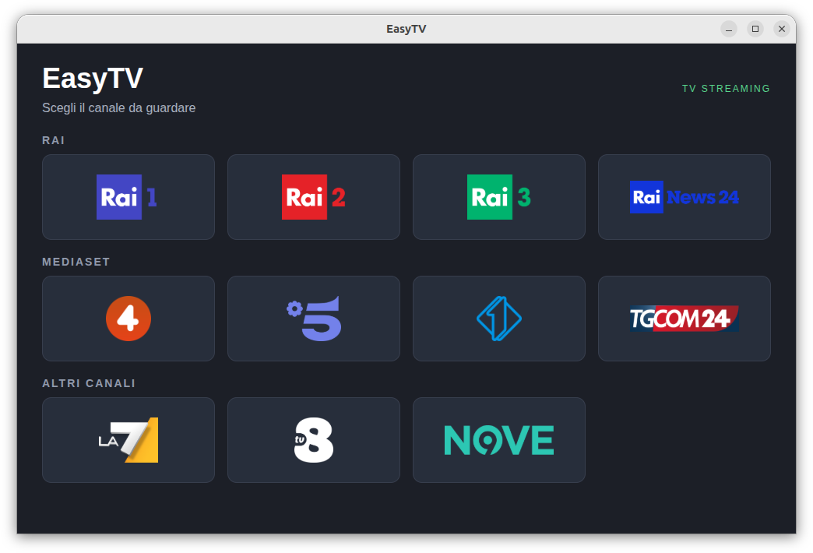

# EasyTV

EasyTV is a simple desktop application for watching live TV channels from your computer.

It provides a straightforward channel-selection window and opens the selected stream in a separate fullscreen window.

## Screenshots

*A picture is worth a thousand words!* :-)



## Features

- Simple channel-selection interface.
- Live TV streaming.
- Fullscreen playback.
- System tray integration.
- Persistent browser session for streaming websites.
- Widevine DRM support through Castlabs Electron.

## Supported platforms

| Platform | Package | Status |
|---|---|---|
| Linux x64 | Debian `.deb` | Tested |
| Windows x64 | NSIS `.exe` installer | Tested |
| macOS ARM64 | `.dmg` / `.zip` | Experimental |

**macOS note:** The macOS application has been successfully packaged, but it has not yet been tested on a physical Mac. In particular, Widevine DRM playback is not yet verified on macOS.

## Installation

### Linux

Download the Debian package and install it:

```bash
sudo apt install ./easytv_1.0.0_amd64.deb
```

Launch EasyTV from your applications menu.

### Windows

Download and run the EasyTV Windows installer (`.exe`).

Follow the installation instructions and launch EasyTV from the Start menu or desktop shortcut.

### macOS

macOS builds are currently experimental and intended for testing.

They are built for Apple Silicon (ARM64). The application is not yet signed or notarized, and compatibility with streaming services and DRM has not been verified on a physical Mac.

## Usage

1. Launch EasyTV.
2. Select a channel.
3. The stream opens in a separate fullscreen window.
4. Press `Esc` to close the streaming window and return to channel selection.

EasyTV can remain available in the system tray.

## Streaming and DRM

Streaming availability and playback quality depend on the broadcaster's website, network connection and regional restrictions.

Some channels use Widevine DRM. EasyTV uses a Castlabs Electron build with Widevine support.

Successful playback may depend on the operating system, browser components and broadcaster changes.

## Support and development

For installation details, build instructions and development information, see [BUILD.md](BUILD.md).

Project repository:

https://github.com/marcolino/easytv