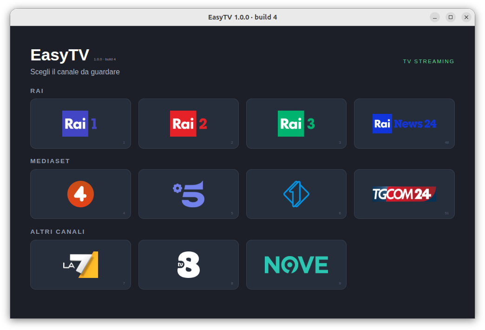

# EasyTV 1.1.0

EasyTV is a desktop launcher for live television, internet radio and subscription streaming services. Its fullscreen Home is designed for use on a television with a mouse, keyboard or keyboard-emulating remote control.



## Installation

| Platform | Package | Status |
|---|---|---|
| Linux x64 | Debian `.deb` / AppImage | Debian tested; AppImage packaging verified |
| Windows x64 | NSIS `.exe` | Earlier builds tested |
| macOS ARM64 and Intel x64 | `.dmg` / `.zip` | Experimental; packaging verified, runtime and DRM unverified |

On Linux, install the downloaded package (adjust the filename as needed):

```bash
sudo apt install ./EasyTV-1.1.0-linux-x64.deb
```

Download packages from [GitHub Releases](https://github.com/marcolino/easytv/releases). On Windows, run the installer. On macOS, experimental builds are unsigned and not notarized. See [BUILD.md](BUILD.md) for development and packaging instructions.

## Using EasyTV

Home displays favorites in configurable groups, with logos and optional numeric shortcuts. The last selected station can be restored on startup. Select a tile or enter its number to open a separate fullscreen playback window. The gear button opens Settings. OFF exits the application; operating-system shutdown is the responsibility of the kiosk environment.

### Keyboard controls

| Key | Action |
|---|---|
| 0–9 | Enter a channel number; an OSD displays the digits |
| Enter / OK | Confirm numeric entry |
| Backspace | Delete the last pending digit, or recall the previous station |
| Esc | Cancel numeric entry or return from ordinary streaming |
| Home | Return from ordinary streaming to Home |
| PageUp / PageDown | Previous/next navigation (TV numeric order or radio favorites; PageUp advances) |
| Space | Play/pause in the radio player |
| F2 | Open Settings |
| F10 | Exit EasyTV; inside interactive web services, return to Home instead |
| F11 | Toggle Home fullscreen |

Numeric entry is confirmed after 1.5 seconds of inactivity, on Enter, or after four digits. TV, radio and services share optional unique numbers from 0 to 9999. Interactive web services receive normal typing, including digits, Backspace and Enter; press F10 to return to Home and press it again to exit EasyTV. Settings text fields are not channel-selection inputs.

A programmable USB infrared receiver can emit these keyboard commands. Raw infrared integration and physical receiver compatibility are not verified.

## Factory favorites

The following 25 entries are selected by default, in group order. Other factory entries remain in the catalogue without being favorites.

| Group | Channel | Number |
|---|---|---:|
| RAI | Rai 1 | 1 |
| RAI | Rai 2 | 2 |
| RAI | Rai 3 | 3 |
| RAI | Rai News 24 | 48 |
| Mediaset | Rete 4 | 4 |
| Mediaset | Canale 5 | 5 |
| Mediaset | Italia 1 | 6 |
| Altri canali | LA7 | 7 |
| Altri canali | TV8 | 8 |
| Altri canali | NOVE | 9 |
| Streaming | Netflix | 101 |
| Streaming | Prime Video | 102 |
| Streaming | YouTube | 108 |
| Radio | Rai Radio 1 | 201 |
| Radio | Rai Radio 2 | 202 |
| Radio | Rai Radio 3 | 203 |
| Radio | Radio Subasio | 204 |
| Radio | Radio 105 | 205 |
| Radio | RTL 102.5 | 206 |
| Radio | Radio Italia solomusicaitaliana | 207 |
| Radio | RDS | 208 |
| Radio | Radio Deejay | 209 |
| Radio | Radio Kiss Kiss | 210 |
| Radio | Virgin Radio | 211 |
| Radio | Radio 24 | 224 |

TGCOM24 (51), Disney+, Apple TV, DAZN, NOW and Paramount+ are also included in the factory catalogue. Numbers and favorites can differ in existing profiles. Factory defaults are not a guarantee of stream availability.

## Settings and catalogues

- Search IPTV-org for TV and Radio Browser for radio; preview results before importing. Search is delayed as you type and results are paginated.
- Use the plus button to add an entry manually. TV requires a name and at least one URL (direct stream or official web player); radio requires a name and audio stream URL. Numbers are optional; the number field has no suggested placeholder.
- The star toggles favorites. Drag handles reorder entries and groups. Group accordions expose membership and visibility controls; opening an accordion closes other open accordions. Save or cancel group edits to close it.
- The catalogue shows small numeric keycaps beneath station names. Play previews a station; the pencil edits it; the trash button removes custom entries. Protected controls explain their limitations. Factory TV channels are protected, factory radio entries can be edited, and factory service numbers can be edited. Factory entries can be removed from favorites without deleting them.
- Duplicate-number errors identify the station occupying the number; invalid-number errors identify the station being edited. Deletions and supported other actions offer a temporary Undo toast.
- Choose English, Italian, French or German in General. Initial language detection uses the system language.

### Logos

Logo search uses external sources including Wikidata/Wikimedia Commons, Radio Browser and known radio defaults. Manual search bypasses the cache and excludes the current logo URL. If an alternative is found, a toast offers Undo for seven seconds. Save the station to persist the replacement. Different URLs may still represent the same image; logos are not compared visually. If no alternative is found, the existing logo is retained.

### Playback modes

Direct is the default when a direct stream URL is available; otherwise Web is used. Explicit playback choices are saved. Older profiles did not store Web choices explicitly, so those entries now follow the new default.

| Mode | Behavior |
|---|---|
| Web | Opens the official broadcaster player |
| Direct | Plays the supplied stream, including HLS through hls.js |
| Auto | Tries direct playback and falls back to the official player after recovery fails |

Only applicable modes are available for each channel. Radio supports ordinary audio streams and HLS, with reconnection and audio visualization where supported. Auto does not diagnose audio/video synchronization issues. Direct TV playback retains a recent video frame during reconnection and displays a loading indicator after approximately one second of stalled playback. Recovery attempts remain bounded.

## Streaming services and DRM

Netflix, Prime Video, Disney+, Apple TV, DAZN, NOW, Paramount+ and YouTube open their official websites. Sign in using the website itself; EasyTV does not collect account passwords. Browser sessions persist in the active profile. A valid subscription may be required. EasyTV uses Castlabs Electron with Widevine support and does not bypass authentication, DRM or regional restrictions.

Netflix login and playback have been confirmed in the Linux development environment. Other services require individual testing. Rai 4 works via its official RaiPlay page; Rai Storia can play fullscreen after a manual Play click, but automatic startup has not been confirmed fixed. Tested alternative Mediapolis URLs returned access errors. Do not assume that every catalogue stream or logo works on every platform.

## Profiles, backup and reset

On Linux, development launches use `~/.config/easytv-dev/` and installed builds use `~/.config/easytv/`. Each has independent settings, catalogues, logo cache and browser sessions. Ordinary updates preserve saved preferences, although new factory entries may be merged into existing catalogues.

The Configuration section in Settings provides export, import and factory reset.

Export saves the committed preferences and custom catalogue entries in a versioned JSON file. It includes numbers, favorites, groups, playback modes, language, last station and logo URLs. It excludes browser cookies, authentication sessions, DRM data, caches and build information. Custom URLs may contain private tokens; keep exports private.

Import replaces the saved configuration rather than merging it. EasyTV validates the file, asks for confirmation, backs up the current settings and catalogues in `import-backup-*`, and restarts. Failed writes are rolled back. Canceling leaves the active configuration unchanged. Browser sessions remain local to the original profile; exporting does not transfer logins between computers.

Restore default configuration (at the bottom of Settings) asks for confirmation, backs up the active profile JSON files into `reset-backup-*`, and restarts EasyTV. It resets favorites, groups, custom entries, playback preferences, language and last station. Browser cookies and DRM data are retained. To restore a backup, close EasyTV and copy its saved JSON files back into the active profile. The other profile is not affected.

The optional system tray is disabled by default. To enable it for a development launch, use `EASYTV_TRAY=1 npm start`. Closing windows may then leave the application running; OFF/F10 on Home explicitly quits.

## Development and support

See [BUILD.md](BUILD.md) and [CHANGELOG.md](CHANGELOG.md). Repository: https://github.com/marcolino/easytv
